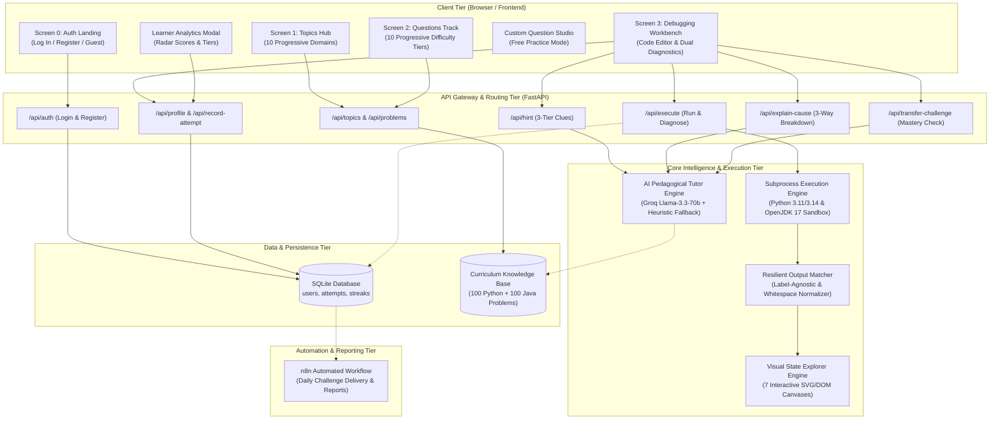
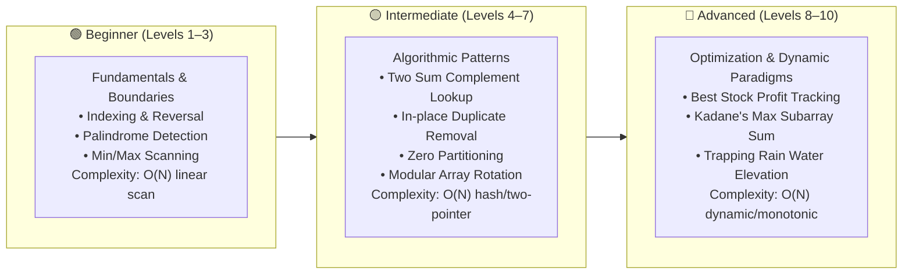
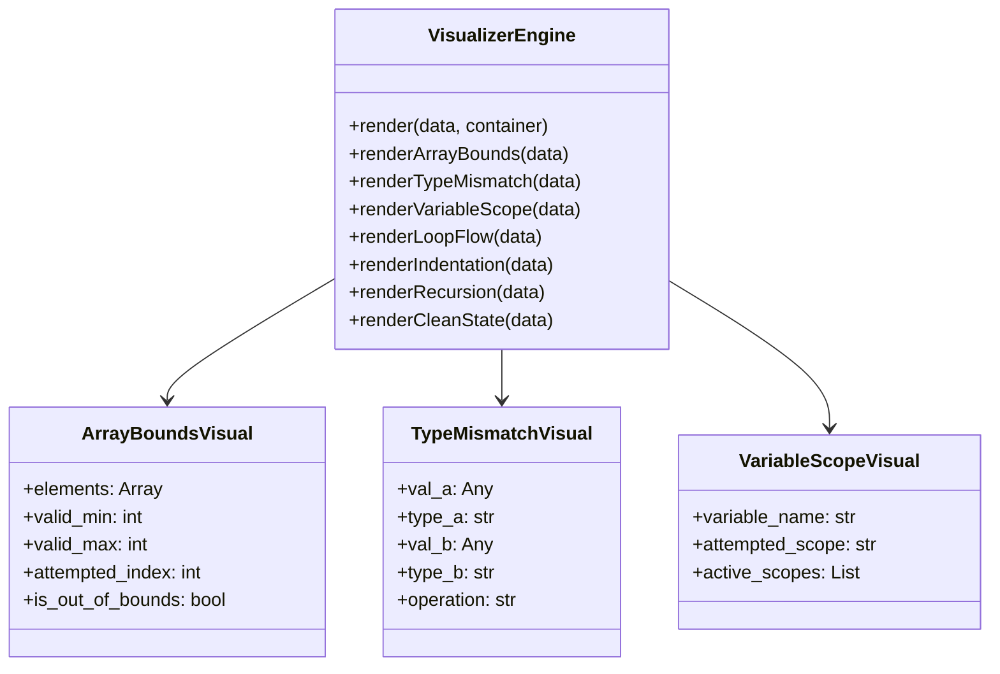

# CodeSense: AI-Powered Interactive Coding, Debugging & Learning Platform
## Comprehensive Technical & Conceptual Documentation

---

## 1. Executive Summary & Problem Formulation

### 1.1 What is the Actual Problem?
When students and junior programmers begin learning programming (in Python and Java), they frequently encounter runtime exceptions and algorithmic bugs:
* **`IndexError`**: Attempting to access an index beyond the boundaries of an array or list.
* **`TypeError`**: Performing operations on incompatible types (e.g., concatenating an integer and a string).
* **`NameError`**: Referencing identifiers, functions, or variables before declaration or initialization.
* **`ValueError`**: Supplying arguments with an invalid value to functions (e.g., `int("abc")`).
* **`IndentationError` / `SyntaxError`**: Violating lexical nesting or language grammars.

Knowing that an error exists is only the starting point. Students also need to understand:
1. **Understanding the Root Cause**: Why did the program fail at this specific step?
2. **Mental Model Divergence**: Where did the programmer's intent diverge from the computer's actual runtime execution?
3. **Prevention**: How can the student internalize the logic pattern to avoid repeating the mistake in future programs?

Consider this common beginner Python program:
```python
numbers = [10, 20, 30, 40]
for i in range(len(numbers) + 1):
    print(numbers[i])
```
* **Student Expectation**: Print all four elements of the list.
* **Runtime Reality**: The loop executes with $i \in \{0, 1, 2, 3, 4\}$. At $i = 4$, it attempts to access `numbers[4]`. Because zero-indexed lists of length 4 only have valid indices $0, 1, 2, 3$, Python halts with an `IndexError: list index out of range`.

---

### 1.2 Why Existing Approaches Fail Learners

| Approach | Typical Workflow | Critical Educational Flaw |
| :--- | :--- | :--- |
| **Traditional Debugging** | Cryptic terminal tracebacks &rarr; Manual Web Search &rarr; Trial-and-error edits | High barrier to entry; beginners get overwhelmed by traceback jargon and lack guidance on where to start. |
| **Conventional AI Coding Assistants** | Student pastes broken code &rarr; LLM spits out fully corrected replacement code | **Premature Spoiler Syndrome**: Bypasses the student's cognitive struggle. The code runs, but the student never internalizes the algorithmic reasoning. |
| **CodeSense Solution** | Identify error &rarr; 3-Way Cause Breakdown &rarr; Progressive Clues (Tier 1 &rarr; 2 &rarr; 3) &rarr; Interactive State Visualization &rarr; Transfer Mastery | **Guided Cognitive Apprenticeship**: Protects student reasoning, explains the divergence gap in plain language, visualizes invisible runtime memory, and proves mastery via isomorphic challenges. |

---

### 1.3 Competition-Ready Problem Statement

> **Problem Statement: CodeSense — An AI-Powered, Hint-First Intelligent Debugging and Programming Learning Platform**
>
> Beginner programmers frequently struggle to diagnose, interpret, and resolve errors in their code. While traditional compilers provide cryptic tracebacks and modern AI code generators produce instant solutions, learners remain reliant on pre-packaged answers without cultivating independent debugging ability.
>
> **CodeSense** bridges this learning gap by providing an interactive, pedagogical programming platform that explains programming bugs in plain language, identifies the root cause through a 3-way cognitive breakdown, and delivers tiered progressive clues without revealing spoilers. Learners are encouraged to predict runtime behaviour, explore interactive visual memory states, iteratively repair their logic, and validate comprehension through isomorphic Transfer Challenges. CodeSense transforms debugging from an intimidating trial-and-error cycle into a structured, measurable, and engaging learning journey that builds lasting programming independence.

---

## 2. Core Architectural Overview

CodeSense is engineered with a modular, decoupled client-server architecture designed for sub-second execution speed, deterministic sandbox security, and pedagogical guidance.

### 2.1 System Architecture Diagram



---

## 3. Deep Dive: Key Platform Features & Modules

### 3.1 Screen 0: Student Authentication & Welcome Portal
* **Design Rationale**: Students need a dedicated landing space to authenticate, preserve their solving history, and protect their daily problem-solving streak before entering the curriculum.
* **Authentication Security**:
  * Passwords hashed using cryptographically salted **SHA-256**.
  * Prevents plain-text credential leaks in database storage.
  * Dual-mode authentication tabs: **Log In** and **Create Account**.
  * Guest Mode (`Continue as Guest &rarr;`) allows instant classroom exploration without credentials while prompting account creation to save progress.

---

### 3.2 10-Topic Curriculum & 10-Tier Progressive Difficulty Roadmap
CodeSense features a hand-crafted, dual-language algorithmic curriculum: **10 Topics &times; 10 Levels = 100 Python Challenges & 100 Java Challenges (200 Total)**.



#### Curriculum Domain Matrix
1. **Arrays & Lists**: Indexing, sliding window, prefix sums, Kadane's algorithm, elevation trapping.
2. **Strings & Text Processing**: Anagrams, palindrome verification, word reversal, frequency maps.
3. **Searching & Loops**: Binary search, peak elements, rotated arrays, exponential scan.
4. **Math & Number Theory**: Armstrong numbers, GCD Euclidean algorithm, prime sieves, modular math.
5. **Conditionals & Branching**: Boundary validations, leap year rules, version comparisons, Roman numerals.
6. **Stacks & Queues**: Valid parentheses matching, Min-Stack $O(1)$, monotonic next greater element.
7. **Recursion & Backtracking**: Divide-and-conquer exponentiation, Tower of Hanoi, power sets, N-Queens.
8. **Binary Trees & BST**: Traversals (Inorder, BFS Level-Order), symmetric mirror checks, max path sum.
9. **Heaps & Priority Queues**: $K$-th largest element, nearly sorted arrays, median from stream, Task Scheduler.
10. **Dynamic Programming**: 1D memoization (Climbing Stairs, House Robber), Coin Change, 0/1 Knapsack, LCS, Edit Distance.

---

### 3.3 Smart Resilient Test Evaluator (Label-Agnostic Matching)
* **The Problem**: Junior students frequently write syntactically correct algorithmic solutions (e.g. `print(rev)`) outputting `[5, 4, 3, 2, 1]`, while the challenge template expects `Reversed: [5, 4, 3, 2, 1]`. Traditional online judges issue an immediate failing penalty over string label differences.
* **The CodeSense Solution**: The execution engine in [`app/main.py`](file:///C:/Users/Akshayaa/.gemini/antigravity/scratch/codesense/app/main.py) incorporates a multi-pass normalization pipeline:
  1. **Direct Substring & Equality Check**: Validates standard identical matches.
  2. **Whitespace & Punctuation Normalization**: Standardizes token spacing, commas, braces, and brackets (`[5,4,3]` vs `[5, 4, 3]`).
  3. **Label Prefix Stripping**: Extracts the core data structure value after common labels (`Reversed:`, `Max Profit:`, `Sorted:`), verifying that the underlying algorithm produced the correct computation.
  4. **Multi-Line Check**: Searches across print output lines to reward students who include exploratory debug prints before their final answer.
  5. **Type Equivalence**: Normalizes case-insensitive booleans (`true` vs `True`) and floating-point representations (`1475` vs `1475.0`).

---

### 3.4 The 3-Way Cause Breakdown
Rather than dumping an intimidating compiler traceback, CodeSense constructs a structured cognitive diagnostic:
1. **Programmer Intent**: What was the student conceptually trying to accomplish? (e.g., *"Visit each item in the array to print its value"*).
2. **Actual Execution**: What did the machine runtime actually perform? (e.g., *"Attempted to access index 4 on a list of length 4"*).
3. **Divergence Gap**: Why do the intent and execution differ? (e.g., *"Zero-indexing means valid indices for size $N$ end at $N-1$. The loop condition allowed $i = N$"*).
4. **Golden Prevention Tip**: A memorable mental rule for future engineering (e.g., *"Golden Rule: The last valid element of any array of length N is always at index N - 1"*).

---

### 3.5 3-Tier Progressive Hint Generator
CodeSense prevents solution spoilers by restricting clues into three distinct pedagogical tiers:
* **Tier 1 (Location & Logic Flaw)**: Pinpoints the problematic line and outlines what went wrong without offering any code.
* **Tier 2 (Core Programming Concept)**: Explains the underlying computer science mechanism (e.g., how zero-indexing works, how variable scoping operates, or how types interact).
* **Tier 3 (Actionable Fix Direction)**: Tells the student exactly what conceptual adjustment to make (e.g., *"Change range boundary from len(arr) + 1 to len(arr)"*), still leaving the actual typing and syntax execution to the student.

---

### 3.6 Interactive Visual Bug Explorer
To demystify invisible program state, CodeSense generates interactive dynamic visualizations based on the error category:



* **Array Bounds Visualizer**: Displays array cells as indexed memory blocks with green borders for valid slots and a flashing red indicator pointing to the out-of-bounds target slot.
* **Type Mismatch Flow**: Illustrates incompatible types colliding inside an operator block (e.g., `String` &larr; `+` &rarr; `Integer`), explaining why the CPU rejects the instruction.
* **Variable Scope Stack**: Visualizes global vs. local frame scope boundaries to show why a variable inside a function is invisible to caller scope.
* **Loop Step Visualizer**: Shows loop step counters, accumulator states, and iteration boundaries.

---

### 3.7 Strict Solve-Only Daily Streak Engine
* **Integrity Rule**: In CodeSense, a student's streak **never** increases upon page load, logging in, or failing test runs.
* **Verification**: The streak increments **strictly** when:
  $$\text{Code Execution Successful} \land \text{All Tests Passed} \land (\text{First Solve of Calendar Day})$$
* **Calendar Continuity**:
  * Solved on day $D$: Streak maintained.
  * Solved on consecutive day $D+1$: Streak increments by $+1$.
  * Missed consecutive day ($>1$ day gap): Streak safely resets to 1 upon the next successful solve.

---

### 3.8 Transfer Challenges: Proving True Algorithmic Mastery
When a student fixes a bug, a common risk is that they made an unreasoned tweak that happened to pass. CodeSense solves this via **Isomorphic Transfer Challenges**:
* The system prompts Groq AI (or curriculum templates) to construct an entirely new problem featuring different business logic and variable names, but governed by the **exact same algorithmic bug pattern**.
* Successfully solving the Transfer Challenge proves the student mastered the underlying mental model.

---

### 3.9 Practice Your Own Question Studio
Beyond the built-in curriculum, CodeSense includes an open **Custom Practice Studio**:
* Students can enter any programming problem from their college coursework, competitive coding, or hobby projects.
* They define their custom Target Expected Goal.
* CodeSense runs their solution, evaluates output, detects runtime bugs, and provides full AI diagnostic breakdowns and clues.

---

## 4. End-to-End User Learning Journey

```mermaid
sequenceDiagram
    autonumber
    actor Student
    participant UI as CodeSense Frontend
    participant Server as FastAPI Server
    participant Sandbox as Subprocess Sandbox
    participant AI as AI Pedagogical Engine
    participant DB as SQLite DB

    Student->>UI: Visits Platform
    alt Not Logged In
        UI->>Student: Displays Screen 0 (Login / Sign Up Portal)
        Student->>UI: Logs in or Clicks 'Continue as Guest'
    end
    UI->>Student: Displays Screen 1 (Topics Catalog)
    Student->>UI: Selects Topic (e.g., Arrays & Lists)
    UI->>Student: Displays Screen 2 (Levels 1–10 Track with Difficulty Roadmap)
    Student->>UI: Selects Level 1 (Reverse Array)
    UI->>Student: Loads Screen 3 (Workbench with Clean Starter Code)
    
    Student->>UI: Writes Code & Clicks 'Run & Diagnose'
    UI->>Server: POST /api/execute {code, language, question_id}
    Server->>Sandbox: Execute in isolated subprocess (3.5s timeout)
    Sandbox-->>Server: stdout, stderr, exit_code
    Server->>Server: Evaluate output via check_outputs_match()
    
    alt Test Failed / Runtime Error
        Server-->>UI: Output Mismatch or Parsed Exception
        UI->>Student: Renders Target Expected vs Actual Output (MISMATCH ❌)
        UI->>Server: POST /api/explain-cause
        Server->>AI: Generate 3-Way Intent/Execution Breakdown
        AI-->>Server: Structured Cause
        Server-->>UI: Cause Breakdown + Visual State Explorer
        Student->>UI: Requests Clue &rarr; Receives Tier 1 Clue
        Student->>UI: Corrects Code & Clicks 'Run & Diagnose'
    end

    Server-->>UI: all_tests_passed == True (MATCH ✅)
    UI->>Student: Confetti Celebration 🎉 + Success Banner
    UI->>Server: POST /api/record-attempt {solved: true}
    Server->>DB: Record attempt & increment Daily Streak
    UI->>Student: Displays [Advance to Level 2: Palindrome Check ➔]
    Student->>UI: Clicks Advance &rarr; Workbench seamlessly loads Level 2!
```

---

## 5. Security & Sandbox Isolation Architecture

1. **Subprocess Isolation**: User-submitted code executes in separate isolated processes via Python's `subprocess.Popen`.
2. **Execution Time Limits**: Hard wall-clock timeout of **3.5 seconds** kills infinite loops (`while True`) and terminates deadlocks.
3. **Memory Safeguards**: Prevents excessive memory allocation from exhausting server host resources.
4. **Environment Isolation**: User processes cannot access server configuration environment keys (`GROQ_API_KEY`).
5. **Safe Data Storage**: User sessions operate with local identifiers; student passwords are protected using SHA-256 salted hashes.

---

## 6. Project Directory Structure

```text
codesense/
├── app/
│   ├── config.py              # Application settings, ports, and model parameters
│   ├── curriculum_data.json   # 200 progressive algorithmic challenges (10x10x2)
│   ├── curriculum_data.py     # In-memory accessors and filtering utilities
│   ├── database.py            # SQLite schema, streak calculator, user auth & analytics
│   ├── main.py                # FastAPI endpoints, output matching & error handling
│   ├── models.py              # Pydantic validation schemas
│   ├── runner.py              # Sandboxed Python & Java execution engine
│   ├── tutor_engine.py        # 3-tier hints, 3-way cause breakdown & transfer challenges
│   └── visualizer_engine.py   # State visualizer schemas (bounds, types, scope, loops)
├── static/
│   ├── css/
│   │   ├── style.css          # Glassmorphism design system & responsive styling
│   │   └── visualizer.css     # Memory cell, pointer, and flowchart styling
│   ├── js/
│   │   ├── app.js             # Main SPA coordinator, view routing & auth handlers
│   │   ├── editor.js          # Code editor manager, tab handler & run triggers
│   │   ├── hints.js           # Tiered hints drawer coordinator
│   │   └── visualizer.js      # Dynamic SVG/HTML visual memory renderer
│   └── index.html             # Single-page application root (Screens 0, 1, 2, 3)
├── n8n_workflows/
│   ├── codesense_student_automation_workflow.json # 9-node student automation workflow
│   └── AI_STUDENT_AUTOMATION_PROJECT_REPORT.md    # Domain & automation project report
├── Dockerfile                 # Debian Bookworm container with OpenJDK 17 + Python 3.11
├── requirements.txt           # Minimal FastAPI, Uvicorn, Pydantic & Groq dependencies
├── codesense.db               # SQLite persistent database
└── run.py                     # Local development launcher
```

---

## 7. Automated Student Workflow (`n8n` Integration)

The project includes an **AI-Powered Student Automation Workflow** packaged in `n8n_workflows/codesense_student_automation_workflow.json`:
* **Node 1: Daily Schedule Trigger** (Fires automatically every morning at 08:00 AM).
* **Node 2: Fetch Student Streak & Profile** (Queries `/api/profile`).
* **Node 3: Retrieve Daily Curated Challenge** (Fetches active level from `/api/problems`).
* **Node 4: AI Personalized Clue Generator** (Generates customized hints via LLM).
* **Node 5: Conditional Branching** (Detects at-risk students who missed their streak).
* **Node 6 & 7: Formatted Morning Challenge Dispatch** (Delivers challenge via Email / Webhook).
* **Node 8 & 9: Progress Sync** (Logs automation delivery to student profile).

### How to Run the n8n Workflow JSON File
1. **Option A: Run in n8n Cloud or Web Dashboard**:
   * Open your n8n workspace (e.g. `https://app.n8n.cloud` or local `http://localhost:5678`).
   * Navigate to **Workflows** &rarr; Click **Add Workflow** (`+`).
   * Click the top-right menu (`...`) &rarr; Select **Import from File**.
   * Choose [`codesense_student_automation_workflow.json`](file:///C:/Users/Akshayaa/OneDrive/Desktop/codesense_student_automation_workflow.json) (located on your Desktop).
   * The 9-node visual canvas will appear. Click **Test workflow** or **Execute workflow**.
2. **Option B: Run via npx command**:
   ```bash
   npx n8n
   ```
   Open `http://localhost:5678` in your browser and import the JSON file.

---

## 8. Summary of Accomplishments & Competitive Advantages

1. **Pedagogically Superior**: Moves beyond simple "code repair" into active student reasoning with structured 3-tier progressive hints.
2. **Visual Learning Support**: Makes invisible pointer arithmetic, memory bounds, and variable frames tangible through interactive visual explorers.
3. **True Algorithmic Progression**: 10 hand-curated levels per topic scaling smoothly from simple loops to dynamic programming.
4. **Honest Discipline**: Strict solve-only daily streak engine ensures genuine coding engagement.
5. **Production Ready**: Fully dockerized, deployed live on Render with automated CI/CD and sub-second execution response times.
