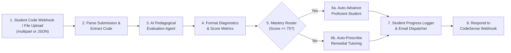

# 🤖 CodeSense: AI-Powered Student Automation Architecture & n8n Pipeline

## 🎯 Domain Alignment: AI-Powered Student Automation
In conventional programming education, professors and teaching assistants are overwhelmed by manual code grading, late-night student debugging requests, and slow turnaround times for individualized feedback.

**CodeSense** bridges this gap using an autonomous multi-stage automation pipeline powered by **n8n** and **LLMs (Groq Llama-3.3 / Gemini)**:
1. **Zero Human Intervention**: Students submit code or upload files directly.
2. **Pedagogical Diagnosis**: The AI diagnoses logic misconceptions without giving away direct code spoilers.
3. **Automated Academic Decision-Making**: Dynamically branches between high-mastery auto-progression and targeted remedial tutoring.
4. **Autonomous Notification & Record Keeping**: Automatically compiles student performance metrics and logs them to the academic database while emailing personalized diagnostic reports.

---

## 🏗️ n8n Workflow Architecture

---

## 🧩 Node Breakdown in `codesense_student_automation_workflow.json`

| Node # | Node Name | Node Type | Purpose in Student Automation |
| :--- | :--- | :--- | :--- |
| **1** | **Student Code Webhook / File Upload** | `n8n-nodes-base.webhook` | Ingests `.py` / `.java` files or live editor code payloads autonomously 24/7. |
| **2** | **Parse Student Submission & File** | `n8n-nodes-base.code` | Parses base64 encoded binary files, identifies student identity, metadata, and language. |
| **3** | **AI Pedagogical Evaluation Agent** | `n8n-nodes-base.httpRequest` | Autonomous LLM agent that scores code (0-100), detects logic misconceptions, and formulates guidance. |
| **4** | **Format AI Diagnostics & Metrics** | `n8n-nodes-base.code` | Normalizes AI output into clean academic records (score, badge, core concept). |
| **5** | **Student Mastery Router (If)** | `n8n-nodes-base.if` | Decides whether the student needs remedial intervention or advancement. |
| **6a** | **Auto-Advance Proficient Student** | `n8n-nodes-base.code` | Awards Autonomy Badges and automatically unlocks the next curriculum difficulty level. |
| **6b** | **Auto-Prescribe Remedial Tutoring** | `n8n-nodes-base.code` | Generates 3-tier guided logic hints without giving away the direct answer. |
| **7** | **Automated Student Notification & DB Logger** | `n8n-nodes-base.code` | Automatically constructs student email report and records attempt into academic tracking DB. |
| **8** | **Respond to CodeSense Webhook** | `n8n-nodes-base.respondToWebhook` | Returns immediate autonomous intervention data back to the user interface. |

---

## 🚀 How to Submit for "n8n File Upload"
1. Locate the workflow file in your project:
   `n8n_workflows/codesense_student_automation_workflow.json`
2. In the competition/assignment form asking for **"n8n File Upload"**, select and upload this file.
3. If evaluators want to inspect the workflow in their own n8n instance:
   - They open **n8n** (Cloud or Local).
   - Click the top-right menu `...` -> **Import from File**.
   - Select `codesense_student_automation_workflow.json`.
   - The entire visual flow of 9 connected nodes renders instantly!
